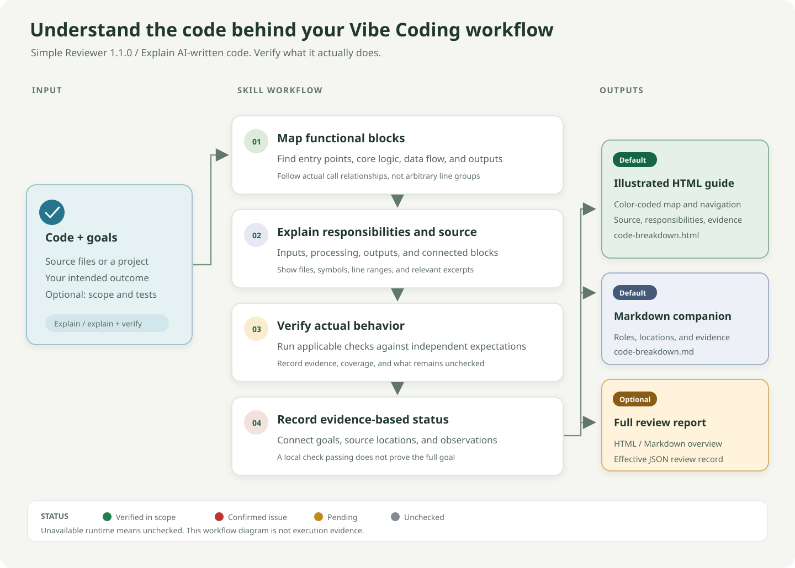
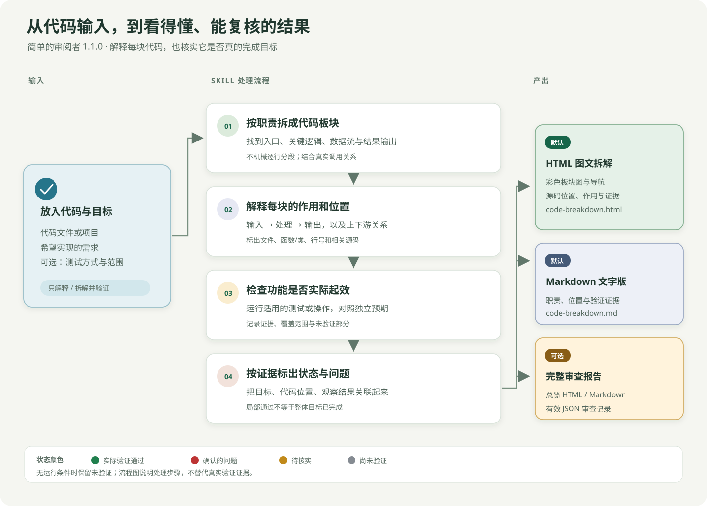

# Simple Reviewer

**Understand and verify the code behind your Vibe Coding workflow.**

[English](#english) · [中文说明](#chinese)

<a id="english"></a>

## AI-assisted coding, with explanations you can check

Simple Reviewer is a Codex skill for people who build and iterate with AI coding agents. It breaks AI-written code into functional blocks, explains what each block does and where it lives, and checks whether the implementation actually meets your goals using recorded evidence.

Use it after a Vibe Coding session, when inheriting unfamiliar AI-generated code, or before accepting a change. Start with a readable explanation, then inspect the behavior, evidence, and remaining gaps. Code that looks plausible is not enough to establish that a feature works.

**Themes:** AI-assisted coding · Vibe Coding · code explanation · evidence-based review.

## How it works

<picture>
  <source media="(max-width: 640px)" srcset="assets/workflow-mobile-en.svg">
  
</picture>

[Full desktop diagram](assets/workflow-overview-en.svg) · [Mobile diagram](assets/workflow-mobile-en.svg)

Provide your code and intended outcome. The skill maps functional blocks, explains their responsibilities and source locations, performs applicable checks, and generates standalone explanations. A full review report is available when requested.

| Output | Files | What you get |
| --- | --- | --- |
| Default | `code-breakdown.html` | Illustrated explanation, block navigation, source excerpts, and verification evidence |
| Default | `code-breakdown.md` | Responsibilities, code locations, findings, and limitations in a text document |
| Optional full review | `report.html`, `report.md`, `review.effective.json` | Review overview, requirements acceptance, and the effective review record |

**Colors describe verification status, not a quality score:** green means verified within the recorded scope; red means a confirmed issue; yellow means pending verification; gray means unchecked. Static reading does not count as a successful runtime check. Missing runtime access is recorded explicitly.

## Features

- Define acceptance criteria from your goals before reviewing the implementation.
- Explain functional blocks through inputs, processing, outputs, and upstream/downstream relationships.
- Identify source files, symbols, line ranges, and relevant code excerpts.
- Connect findings to actual observations, evidence, and verification limits.
- Read offline HTML reports with diagrams, keyboard navigation, expandable source, filtering, and print support.
- Detect changes to registered source files and evidence logs with SHA-256 snapshots; stale evidence requires revalidation.

The generator validates and displays an authored review record. It does not execute recorded commands or discover semantic defects on its own. The reviewing agent reads the code, performs appropriate checks, and records the results.

## Install and use

Copy the complete `simple-reviewer-v1` directory into your configured Codex personal skills directory. The default Windows location is:

```text
%USERPROFILE%\.codex\skills\simple-reviewer-v1
```

Start a new Codex conversation or refresh the skill list, then ask:

```text
$simple-reviewer-v1 Review the code we just changed. Explain each functional block,
identify its source locations, verify whether it meets my goals, and generate
an HTML breakdown with a Markdown companion. Review only; do not change the code.
```

You do not need to repeat this wording exactly. The skill currently defaults to Simplified Chinese for explanations and reports; request English explicitly when needed. This bilingual README does not change that default.

Tool version: **1.1.0**. Invocation: `$simple-reviewer-v1`. Display name: **Simple Reviewer · 简单的审阅者1.0**. Update the complete installed directory to include the generator and templates; updating `SKILL.md` alone is insufficient. Further Chinese documentation: [usage guide](使用说明.md) and [review record contract](references/report-contract.md).

To update an existing installation, run `powershell -NoProfile -File scripts/sync-installed-skill.ps1` from this checkout. It installs and hash-verifies the complete skill, archives the previous installation outside the active skills directory, and preserves the old files as a backup. Open a new Codex conversation to use the new invocation.

## Validate and generate reports

Python 3 is required; the generator uses only the standard library.

```text
python -B scripts/test_reviewer_report.py
python -B scripts/reviewer_report.py validate assets/review.example.json
python -B scripts/reviewer_report.py breakdown assets/review.example.json --out review-output
python -B scripts/reviewer_report.py render assets/review.example.json --out review-output
```

Open `review-output/code-breakdown.html` for the illustrated explanation. `breakdown` produces HTML and Markdown; `render` additionally produces the full review files. Existing schema `1.0` records remain supported.

The bundled order-export example deliberately contains a pagination bug: exporting more than 20 matching orders loses records. Rebuild its reproducible evidence with:

```text
python -B assets/order-export/build_example.py
```

The example is not evidence for your project. Generated reports may include source code and local paths; share them according to your project's rules.

Optional browser checks require Node.js and Playwright; the report generator does not:

```text
npm install --no-save --package-lock=false playwright@1.56.1
npx playwright install chromium
node scripts/test_breakdown_browser.cjs review-output/code-breakdown.html review-output/browser
```

CI runs Python tests on Windows and Linux and checks the illustrated report in Chromium, including source expansion, keyboard navigation, filtering, offline requests, and 390/700/1024px layouts. The example reports and screenshots are attached to Actions runs.

## Repository publishing

Maintainers can run `powershell -NoProfile -File scripts/publish-github.ps1` from a clean, committed `main` checkout. It pushes `main`, applies the repository name, bilingual About description and topics from [repository metadata](assets/github-metadata.json), updates the local origin after a successful rename, preserves existing topics, and verifies the result. It uses the configured Git credential helper in memory; the account must have permission to edit repository settings. If a metadata request fails after the push, rerun the script after resolving access. Add `-UpdateInstalledSkill` to migrate the personal skill installation in the same run.

The helper uses OpenSSL and HTTP/1.1 for Git. It also uses the Windows system proxy when no Git or proxy environment setting is present. If Git reports a connection reset or timeout, pass `-ProxyUrl` with the actual HTTP proxy address shown by your proxy application. The override applies only to this run; it does not edit global Git configuration. A browser connection alone does not verify the Git connection.

## License

No open-source license is currently included. Rights and reuse permissions remain with the rights holder unless a license is added.

---

<a id="chinese"></a>

# 简单的审阅者 1.0 · 中文说明

一个 Codex skill，可用于拆解ai编写或修改的代码，说明各功能板块的作用和代码位置，并用可复核的运行证据检查作用是否生效、原始需求是否完成--辅助你与ai代码共同工作。适用于重度ai编码依赖，可以在不太懂代码编写的同时读懂ai写的代码结构和思路。

**主题：AI 辅助编程 · Vibe Coding · 代码解释 · 基于证据的审查。** 适合在 AI 编程完成一个功能后、接手不熟悉的 AI 代码时，或接受修改前使用。先读懂代码，再核对它是否完成目标。

[Back to English / 返回英文](#english)

## 使用流程

<picture>
  <source media="(max-width: 640px)" srcset="assets/workflow-mobile.svg">
  
</picture>

[查看横版完整流程图](assets/workflow-overview.svg) · [查看手机纵版流程图](assets/workflow-mobile.svg)

将代码和希望实现的目标交给 skill。它先按职责拆解代码，说明每块的作用和位置，再根据可运行的检查核验实际行为，最后生成独立的 HTML 图文拆解与 Markdown 文字版。需要完整审查时，还可生成总报告和有效记录。

| 产出方式 | 文件 | 阅读内容 |
| --- | --- | --- |
| 默认生成 | `code-breakdown.html` | 图文拆解、板块导航、源码与验证证据 |
| 默认生成 | `code-breakdown.md` | 板块职责、代码位置、结论与限制的文字版 |
| 可选完整报告 | `report.html`、`report.md`、`review.effective.json` | 审查总览、需求验收和有效记录 |

**颜色表示检查状态，不是文件质量评分：** 绿色为在所记录范围内实际验证通过，红色为有证据确认的问题，黄色为待核实，灰色为尚未验证。缺少运行条件时会明确说明，不会把静态阅读说成运行通过。

## 功能

- 先依据用户目标建立验收项，再按实际职责划分代码板块。
- 默认生成独立的 `code-breakdown.html` 图文页面和 `code-breakdown.md` 文字版：逐块解释职责、输入输出、文件/符号/行号、源码片段、验证状态、证据和限制。
- HTML 内置板块导航、输入→职责→输出示意、可选步骤图和教学样例；支持源码展开、点击/键盘跳转、筛选及打印，离线可读，适配手机。
- 使用流程图标记状态：README 使用 SVG 展示整体处理流程，审查报告使用 Mermaid/SVG 展示代码职责；绿色表示范围内验证通过，红色表示已确认问题，黄色表示待核实，灰色表示未验证。
- 支持生成 Markdown 和离线 HTML 审查报告；报告生成器只校验记录并渲染，不执行记录内的命令。
- 提供 SHA-256 文件快照校验和 Python 标准库测试。

绿色状态只适用于明确记录的输入、环境和验证范围，不代表所有场景正确。缺少源码、依赖或环境时应保留未验证状态。

## 安装

将 `simple-reviewer-v1` 目录复制到 Codex 个人 skills 目录下。Windows 默认路径为：

```text
%USERPROFILE%\.codex\skills\simple-reviewer-v1
```

安装后在 Codex 中新开会话或刷新 skill 列表，然后调用：

```text
$simple-reviewer-v1 检查刚刚的代码，并单独生成代码拆解文件。
```

完整使用方法见 [使用说明](使用说明.md)。报告 JSON 格式见 [报告记录规范](references/report-contract.md)。

## 检查

要求 Python 3，无第三方依赖：

```powershell
python -B scripts/test_reviewer_report.py
python -B scripts/reviewer_report.py validate assets/review.example.json
python -B scripts/reviewer_report.py breakdown assets/review.example.json --out .\review-output
python -B scripts/reviewer_report.py render assets/review.example.json --out .\review-output
```

内置订单导出示例故意保留“复用列表分页导致超过 20 条时导出不完整”的缺陷。构建示例会运行可复现检查并重写示例日志：

```powershell
python -B assets/order-export/build_example.py
```

示例报告不是其他项目的检查结果。

打开 `review-output/code-breakdown.html` 看图文拆解。`breakdown` 输出 HTML 和 Markdown 两个独立文件；`render` 再附总审查报告和有效记录。现有 `review.json` 兼容，缺少图文补充字段时仍自动生成输入输出图、源码与证据卡。

当前工具版本为 **1.1.0**，skill 调用名为 `$simple-reviewer-v1`，界面名为“Simple Reviewer · 简单的审阅者1.0”。更新时用仓库完整内容替换原安装目录；仅下载单个 `SKILL.md` 不会更新模板和生成器。生成页面可能含源码与本地路径，请按项目约定保存和分享。

已有安装可在此仓库运行 `powershell -NoProfile -File scripts/sync-installed-skill.ps1`：脚本安装完整新版并校验文件哈希，将旧安装备份到启用中的 skills 目录之外。旧文件会保留为备份。新开 Codex 对话后使用新调用名。

可选浏览器自检（生成器本身无需 Node 或 Playwright）：

```text
npm install --no-save --package-lock=false playwright@1.56.1
npx playwright install chromium
node scripts/test_breakdown_browser.cjs review-output/code-breakdown.html review-output/browser
```

CI 在 Windows/Linux 运行 Python 测试，并在 Chromium 检查源码展开、键盘跳转、筛选、390/700/1024px 宽度及离线请求；订单示例 HTML 和截图随 Actions 产物保存。

## 仓库发布

维护者可在已提交且无未保存修改的 `main` 分支运行 `powershell -NoProfile -File scripts/publish-github.ps1`。脚本会推送 `main`，读取[仓库元数据](assets/github-metadata.json)设置仓库名称、英中双语 About 简介和主题标签，改名成功后更新本地 origin，保留已有标签，并回读核对。凭据仅通过现有 Git 凭据助手在内存中使用；账号需有修改仓库设置的权限。如果推送后设置简介或标签失败，解决访问问题后可重新运行脚本。追加 `-UpdateInstalledSkill` 可在同一次运行中迁移个人 skill 安装。

脚本对 Git 使用 OpenSSL 和 HTTP/1.1；没有现有 Git 或代理环境设置时，会尝试使用 Windows 系统代理。若 Git 报连接重置或超时，可通过 `-ProxyUrl` 传入代理软件显示的实际 HTTP 代理地址。本次参数不会修改全局 Git 配置。浏览器能连接 GitHub，并不代表 Git 的连接也已通畅。

## 许可证

当前版本未附开源许可证。除非作者另行添加许可证，版权及复用权限仍由权利人保留。
